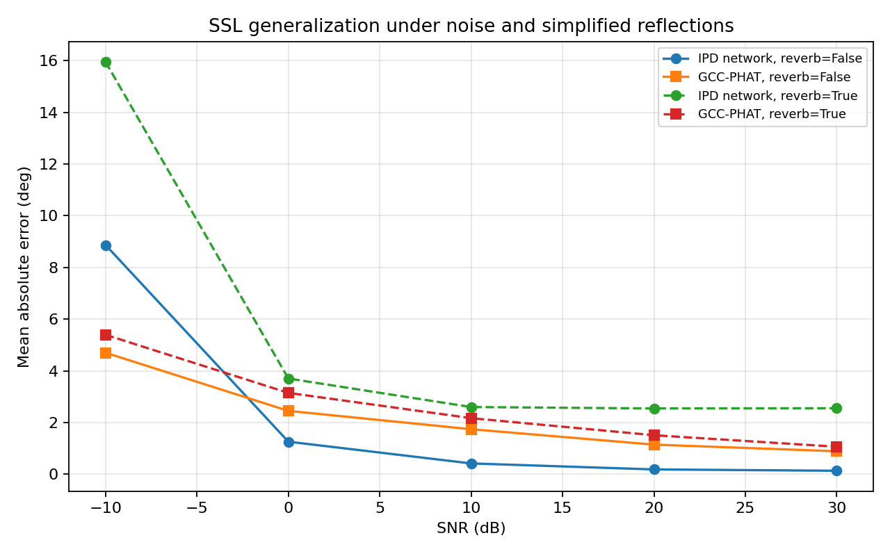
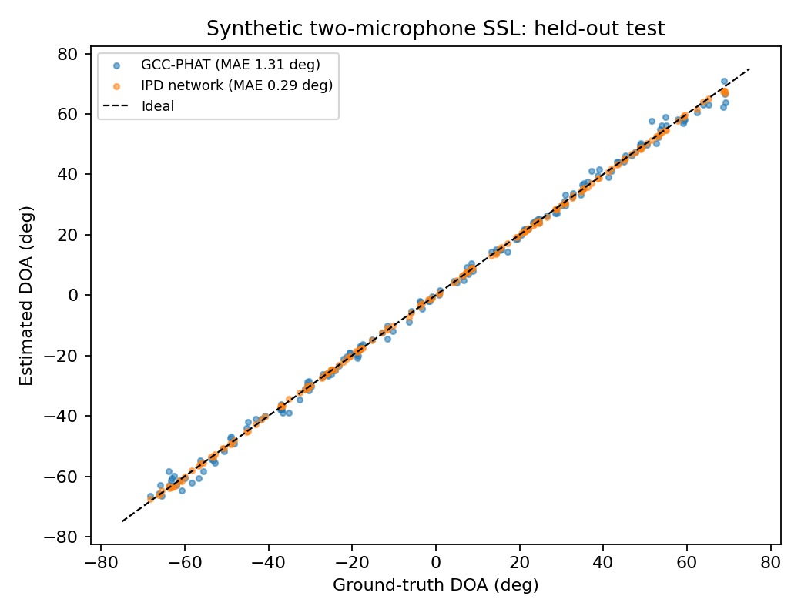

# Two-Microphone Sound Source Localization: GCC-PHAT vs Neural IPD

**A reproducible educational baseline using simulated audio (not real-room measurements).**

This project compares classical **GCC-PHAT** localization with a small **PyTorch multilayer perceptron (MLP)** trained on observed inter-channel phase difference (**IPD**) features. Its purpose is to test a signal-processing-to-learning pipeline and evaluate **generalization under noise and simplified multipath reflections**, rather than to claim a new SSL algorithm.

## At a glance

- **Geometry:** 2 synchronized simulated microphones; spacing **0.20 m**; sampling rate **16 kHz**; sound speed **343 m/s**; azimuth measured from broadside (right positive).
- **Signal processing:** microphone waveforms → STFT → cross-spectrum → GCC-PHAT → TDOA → DOA.
- **Learning baseline:** microphone waveforms → STFT → 24 frequency-bin IPD cosine/sine pairs (**48 input features**) → MLP (48→64→32→1) → predicted `sin(DOA)` → DOA.
- **Training:** 800 synthetic examples, 160 validation, 160 independent held-out test examples; angles uniformly sampled from **−70° to +70°**; SNR **8–30 dB**; no reflections in training or original held-out test.
- **Robustness test:** 50 fresh examples per condition; SNR values **30, 20, 10, 0, −10 dB**, each with and without simplified reflections. Same sources, directions, and noise seeds are reused across conditions for controlled comparison.

## Selected results

**Held-out direct-path test (160 examples; synthetic 8–30 dB SNR):**

| Method | Mean Absolute Error (MAE) |
|:--|--:|
| Neural IPD baseline | **0.29°** |
| GCC-PHAT | 1.31° |

**Out-of-distribution robustness check (50 examples per condition):**

| SNR | Simplified reflections | Neural IPD MAE | GCC-PHAT MAE |
|--:|:--:|--:|--:|
| 30 dB | No | 0.14° | 0.89° |
| 10 dB | No | 0.42° | 1.74° |
| −10 dB | No | 8.87° | 4.70° |
| 30 dB | Yes | 2.55° | 1.07° |
| −10 dB | Yes | 15.95° | 5.39° |

Complete results for all 10 conditions are in [`results/robustness_summary_50.csv`](results/robustness_summary_50.csv). All metrics are computed on **synthetic generated signals**, not captured audio.





**Main observation:** the IPD MLP performs well on the direct-path simulation close to its training distribution; it generalizes poorly to the untrained reflection conditions and very low SNR, where GCC-PHAT is more robust under several tested conditions. These are findings for the *specified simulation and baselines only*.

## Reproduce on Windows (PowerShell)

Requires Python 3.10+ with access to PyPI. The CPU build of PyTorch is sufficient.

```powershell
py -m venv .venv
.\.venv\Scripts\python.exe -m pip install -r requirements.txt

# Classical localization demonstration
.\.venv\Scripts\python.exe main.py --angle 30 --snr 30 --out outputs_demo

# Multi-angle classical baseline
.\.venv\Scripts\python.exe evaluate.py --out outputs_eval

# Train neural model + compare on the original held-out direct-path set
.\.venv\Scripts\python.exe lesson06_6.py

# Evaluate WITHOUT retraining the network (requires the saved model above)
.\.venv\Scripts\python.exe lesson06_7.py --count 50

# Lightweight sanity checks
.\.venv\Scripts\python.exe -m unittest discover -s tests -v
```

After training, `outputs_ipd/ipd_doa_model.pth` stores the neural model. Generated files go to `outputs_*` folders and are git-ignored. Representative published figures and CSV summaries are already included in `results/` so readers can inspect experiments without training.

**To verify the 10-row table:** open `outputs_generalization/summary.csv` after running the robustness test and compare with `results/robustness_summary_50.csv`. Small differences may occur across library versions/platforms.

## Methods and important distinctions

### Classical baseline

The arrival-time difference is defined as `tau21 = t2 - t1`, with Mic 1 on the left and Mic 2 on the right. The broadside direction is 0°; positive DOA points right.

For a single far-field source:

```text
tau21 = -(d / c) * sin(theta)
theta = asin(-c * tau21 / d)
```

The GCC-PHAT implementation estimates inter-microphone delays via averaged STFT cross spectra, PHAT weighting, inverse FFT, and a constrained peak search.

### Neural IPD baseline

The MLP input is observed phase information derived from noisy *microphone signals*, **not** ground-truth delays, angles, or clean oracle signals. Features are 24 low-frequency bins with real/imag components of the unit cross spectrum. Targets are `sin(theta)`. Training uses MSE and Adam.

Validation is used to report training progress; the held-out test is used only for the final direct-path evaluation. The additional robustness set uses different random draws, while sharing the same educational signal generator.

### What the simulation does NOT cover

- **No real recorded microphones**, channel hardware mismatch, or synchronization errors.
- **No physically validated room impulse responses (RIRs) or RT60**; `--reverb` adds a few predetermined reflection delays/amplitudes as a deliberately simplified model.
- **No multi-speaker mixtures, moving sources, or front/back disambiguation.** A two-microphone linear array in this setup cannot resolve full front/back ambiguity.
- The MLP is trained on one fixed array geometry and synthetic source/noise distribution; generalization to other arrays/rooms is unknown.
- These results do not establish general or real-world superiority of neural IPD over GCC-PHAT. Both approaches are well-known baselines; this is not an original research claim.

## Repository layout

```text
.
├── main.py                # Simulate two channels + GCC-PHAT baseline
├── evaluate.py            # Multiple-angle classical baseline
├── lesson06_6.py          # Train IPD MLP + held-out test
├── lesson06_7.py          # Noise/reflection robustness sweep
├── results/               # Representative PNG plots and CSV metrics
├── tests/test_smoke.py    # Basic physics/tensor sanity tests
├── requirements.txt
└── .gitignore
```

## Research context / next steps

Explore training with room acoustics simulated by physically motivated RIRs, multiple array geometries, and real two-microphone recordings. Study direct-path phase modeling (DP-IPD / DP-RTF), FN-SSL and IPDnet for more robust localization.

## Transparency

Created as an educational project using AI-assisted starter code and student-led execution, verification, experiment comparisons and interpretation. Report only work you can explain and reproduce, and distinguish model implementations from new algorithms.
